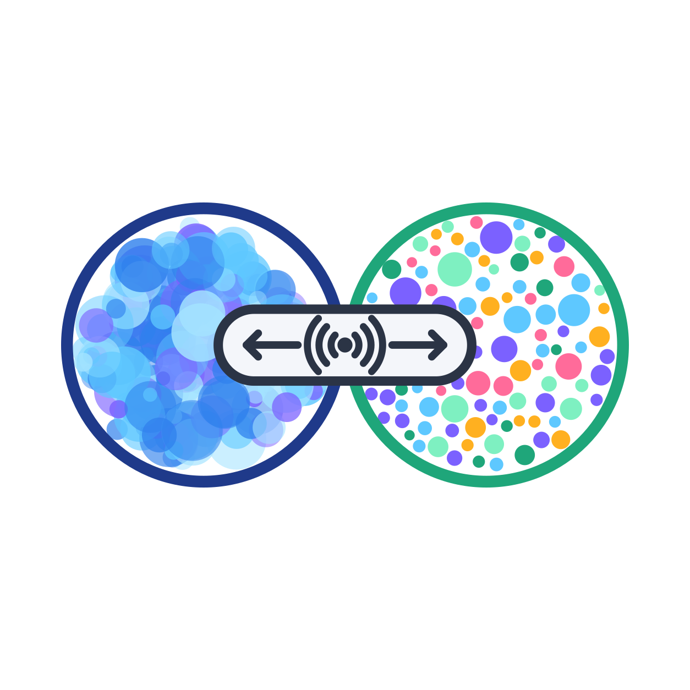

<p align="center">
  
</p>

# SplatLink

SplatLink turns videos and photos into 3D Gaussian splats on your own PC. A companion Android app will capture on the phone and send the files to the PC.

- Website: https://splatlink.app
- Help and support: https://whiterott.github.io/splatlink-help/
- Report an issue: https://github.com/WhiteRott/splatlink-help/issues

**Status:** in development.

## Based on OOOSplat

SplatLink is based on [OOOSplat](https://github.com/ooolabdev/ooosplat) by ooolabdev, under the Apache License 2.0. SplatLink is not an official OOOSplat product.

- The license is in [LICENSE](LICENSE). Attribution is in [NOTICE](NOTICE).
- The changes to the original files are listed in [MODIFICATIONS.md](MODIFICATIONS.md).
- Third-party licenses are in [licenses/](licenses/).
- The original OOOSplat documentation is in [docs/upstream/](docs/upstream/).

## Build from source (Linux)

1. Install Node.js 22.12 or later, Rust stable and the Tauri 2 system packages.
2. Install the packages:
   ```bash
   npm install
   ```
3. Download and check the engines (COLMAP and Brush):
   ```bash
   npm run setup:engines
   npm run verify:engines
   ```
4. Start the app:
   ```bash
   npm run dev:local
   ```

On a PC with more than one GPU, select the training GPU. On Linux, `VK_DRIVER_FILES` limits Vulkan to one driver, for example:

```bash
VK_DRIVER_FILES=/etc/vulkan/icd.d/nvidia_icd.json npm run dev:local
```

## License

Apache License 2.0. See [LICENSE](LICENSE) and [NOTICE](NOTICE).
